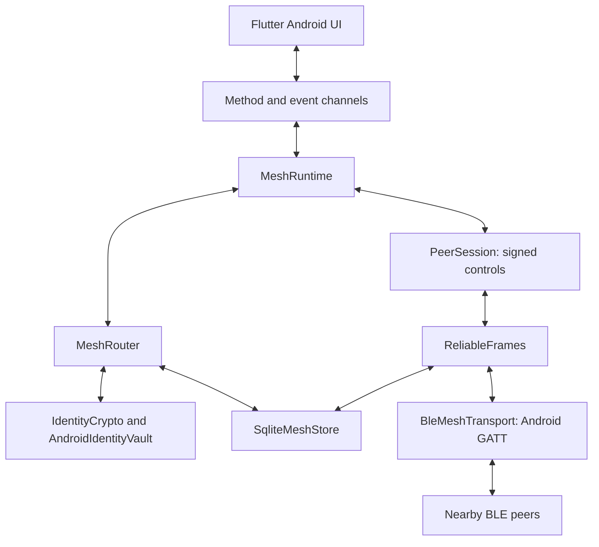

# Mesh v2 architecture

This describes the implemented Android v2 source. Compilation, automated test
results and artifact evidence are recorded separately in
[BUILD_REPORT.md](../BUILD_REPORT.md). Source implementation and JVM tests do
not establish physical BLE delivery; device acceptance remains unexecuted
unless a dated device-test record states otherwise.

## Components and platform boundary

| Source | Responsibility |
| --- | --- |
| Flutter `lib/mesh` | Riverpod state, onboarding, signed QR contact import, Chats/Nearby/Mesh/Settings, diagnostics and visible errors |
| `MainActivity`, `MeshRuntime` | `offlinechat/mesh` method channel, `offlinechat/mesh_events` updates, runtime permissions, snapshots, inventory and custody coordination |
| `IdentityCrypto`, `AndroidIdentityVault`, `EnvelopeCodec` | Key ownership, bounded identity documents, Tink primitives, envelope/route validation and encrypted local history |
| `PeerSession` | Fresh mutual signing-key challenges and signed, sequential control messages |
| `SqliteMeshStore`, `MeshRouter` | Atomic ciphertext admission, verified contacts, encrypted history, deduplication, forwarding, receipts, quotas and backoff |
| `BleMeshTransport`, `ReliableFrames` | Android scanner/advertiser, GATT server/client, subscriptions, serialized operations, MTU-sized fragments, ACK/retry and durable journals |
| `MeshForegroundService` | User-started `connectedDevice` foreground service, generic notification and stop action |

The runtime owns database, crypto, router and session work on one executor;
the transport owns BLE state on a separate `HandlerThread`. Flutter receives
public state and decrypted local chat text through the bridge, never private
keysets or the AndroidKeyStore wrapping key. Production peer discovery and
transfers use Android BLE callbacks, with no Internet transport or backend.

Android 10/API 29+ selects this mesh UI. Windows retains the existing v0.2
direct-chat UI and protocol; it is not a v2 encrypted mesh peer. The v2 BLE
service UUID is distinct from the legacy service. Existing plaintext legacy
preferences are not imported, encrypted or converted into verified contacts.

## Identity, keys and content encryption

The dependency is Google Tink Android **1.24.0**. The selected primitives are:

| Purpose | Primitive |
| --- | --- |
| Identity, envelope, route and session signatures | Ed25519 with Tink `ED25519WithRawOutput`, producing standard 64-byte signatures |
| End-to-end envelope encryption | RFC 9180 HPKE: X25519, HKDF-SHA256 and AES-128-GCM, using `HPKE_X25519_HKDF_SHA256_AES_128_GCM` |
| Local message-history encryption | Separate Tink AES-256-GCM keyset |
| Private keyset storage | Explicit AndroidKeyStore AEAD wrapping through Tink's AndroidKeyStore integration |

The app does not implement curve arithmetic, KDFs or AEAD algorithms itself.
Use of maintained primitives does not make this custom protocol audited.

A fingerprint is SHA-256 over domain-separated, length-prefixed encodings of
both public keysets. The identity self-signature binds that fingerprint,
display name and both keys. The parser permits one enabled Ed25519 public key
and one enabled X25519 HPKE public key with the specified parameters. Names,
versions, encodings, public keyset sizes and signatures are bounded. QR export
is a canonical unpadded URL-safe base64 document prefixed `offlinechat:v2:`;
it contains no network link. Renaming changes the signed display name while
preserving the key fingerprint. Human trust still requires explicit
QR/fingerprint confirmation with the intended person.

The vault persists only encrypted signing, HPKE and history keysets in private
preferences. Each purpose has separate associated data. There is no cleartext
keyset fallback: incomplete/corrupt stored state, a missing wrapping key or
KeyStore failure stops initialization instead of replacing an existing
identity. Normal loads also reject an entirely missing vault; only explicit
initial onboarding requests creation with `createIfMissing=true`. The public
display name is stored separately. Android backup and device-transfer
exclusions cover app storage. Hardware backing depends on the device; it is
not inferred from the KeyStore API name. The test factory uses real ephemeral
Tink keys in memory and does not persist them.

HPKE binds the encrypted body to the immutable envelope header. An Ed25519
signature covers that header and ciphertext. A relay validates these fields
without possessing the intended recipient's private HPKE key. The recipient
also requires the sender's fingerprint and keys to match a verified contact
before accepting text into its history. History encryption authenticates its
public row metadata and uses associated data bound to the local fingerprint.
SQLite is not encrypted as a whole: contacts, routes, queue metadata and
encrypted record lengths remain visible locally.

## Envelope and signed route

`EnvelopeCodec` implements a bounded version-2 binary envelope containing a
UUIDv4 message ID, full signed sender identity, recipient fingerprint,
creation/expiry times, maximum hops, text/receipt kind, ciphertext and sender
signature. Plaintext is limited to 1,024 bytes; the complete routed packet is
limited to 32 KiB. Decoders reject malformed lengths, unsupported versions,
invalid UTF-8 and trailing bytes. Deduplication binds the message ID to the
immutable signed-envelope SHA-256 digest; a conflicting digest is rejected.

Each transfer adds a signed route edge containing the envelope digest, the
previous edge digest, the signer's identity, intended next custodian and
one-based index. The first edge starts at the envelope sender. Subsequent
edges join the prior target, use sequential indices and cannot revisit any
node. The receiver checks that the final edge targets itself and that the
last signer matches its authenticated transport peer. A sender may hold its
own locally queued envelope with an empty route; an incoming transfer may
not omit that origin-signed first edge. Relays can append only while they are
the current custodian and the signed hop budget permits another edge.

These checks protect against intermediaries resetting a mutable hop counter,
stripping earlier proofs or substituting a peer. They do not force a relay to
forward. Expiry uses each phone's wall clock, with a five-minute permitted
future creation skew and a maximum signed lifetime of seven days. There is
no network clock service.

## Sessions, BLE transfer and acknowledgment boundaries

For every BLE link, `PeerSession` exchanges signed public identities and fresh
32-byte random nonces. Each side signs a domain-separated transcript binding
both fingerprints and nonces. Only a valid proof enables controls. Exact
control bytes are signed with the transcript digest and a strictly increasing
per-direction sequence number; signatures are checked before JSON processing.
Repeated/reordered controls and proof/control replay into a fresh session are
rejected. Authenticated relays may be unknown contacts. Session controls are
authenticated, not independently encrypted; application content remains inside
the end-to-end encrypted envelope.

The transport advertises a v2 service plus a per-start random tag, scans for
that service and runs GATT central/server roles with at most three links. A
link becomes ready only after its real notification subscription is enabled.
GATT operations are serialized. Negotiated ATT payloads are bounded to
20–244 bytes. `ReliableFrames` uses stop-and-wait fragments, a two-second ACK
timeout, three retries and bounded transfer/journal queues. Fragment progress
is written to SQLite before a fragment ACK is sent.

The three acknowledgment boundaries are separate:

1. A **fragment ACK** confirms durable frame progress. Even the final frame
   ACK does not mean that the asynchronous runtime has admitted a valid full
   envelope. Reassembly hands the payload to the runtime executor; the frame
   layer can clear its completed journal and ACK before that later admission.
2. A signed **custody control** is sent only after the router has validated and
   durably committed the complete envelope, or established an identical
   previously accepted digest. The sender matches its in-flight ID/digest and
   authenticated peer before recording custody. This can advance **Relayed**.
3. Only an **encrypted, signed receipt from the original intended recipient**,
   bound to the original message ID/digest and valid delivery time, can advance
   **Delivered**. Frame progress or relay custody cannot do so.

Completed envelope queues survive process interruption. A new encounter uses
a fresh authenticated session and bounded inventory reconciliation to resend
missing full envelopes; it does not replay stale signed session controls or
promise byte-offset continuation under a new link. Interrupted fragment
journals are retained temporarily and expire after 30 minutes. Authentication,
inventory progress and custody have timeouts; send failures close the broken
session and retain the queued envelope for reconciliation.

## Queue, forwarding and persistence

Defaults are eight maximum hops, 24-hour TTL and 25 MiB of queued envelope
bytes. Settings accept 1–16 hops, 60–604,800 seconds and 1–100 MiB. Admission
also has a fixed **4,096 complete-envelope cap**, including locally generated
delivery receipts. Both the byte limit and count cap apply. Inventories use
128-token pages, up to 32 pages, so every admitted queue entry fits one cycle.
Each token includes the ID and immutable digest. Inventory is synchronized on
authentication and refreshed after completed cycles while connected.

The router prioritizes packets for the directly connected recipient, then
delivery receipts, then older eligible traffic. It rejects expired packets,
invalid routes, conflicting IDs and exhausted hop budgets. Disabling relay
participation stops new third-party admission and third-party forwarding;
the device's own messages and receipts can still travel. Quota rejection is
reported without custody ACK. Backoff and per-peer control/envelope rate
limits bound local work.

`SqliteMeshStore` uses transactions and `synchronous=FULL`. Incoming text,
encrypted history and its generated receipt are committed atomically. An
accepted ID/digest is retained through expiry plus clock skew for replay
protection. Expired queue records are removed; local history remains encrypted
and outgoing pending/relayed history becomes expired. Additional fixed bounds
include 500 contacts, 10,000 history rows and 100,000 replay records. Fragment
journals have separate transfer, count, byte and age limits; the user queue
setting is not a bound on the entire database file.

Database schema version 2 adds frame journals to the native mesh schema without
discarding v1 mesh queue/history records. This migration is separate from the
legacy direct app's plaintext preferences, which remain untouched.

## Verification and threat boundaries

Automated suites cover real-Tink identity/envelope/hop tampering, confidentiality
between recipients and relays, local AEAD, mutual sessions, sequence and fresh
session replay, bounded codecs, router/receipt policy, frame reliability and
SQLite behavior. Actual executed checks and counts belong in
[BUILD_REPORT.md](../BUILD_REPORT.md). AndroidKeyStore instrumentation tests
exist but have not run on an Android target; no physical three-phone,
delayed-encounter, process-kill or background test has run here.

Encryption does not hide identities, public keys, timing, length, routes,
encounters or traffic volume. There is no message-key ratchet, post-compromise
recovery, identity revocation service, anonymous routing, Sybil resistance or
guaranteed delivery. Losing recipient private keys loses access; compromising
them can expose recorded envelopes. Independent review of the custom protocol
and physical acceptance in
[PHYSICAL_DEVICE_TEST_PLAN.md](PHYSICAL_DEVICE_TEST_PLAN.md) remain necessary.
